# AquaSense

[](https://github.com/Ankit02124/AquaSense/actions/workflows/tests.yml)

Fish pond monitor designed for the Arduino UNO Q. A YOLOv8n model watches the fish through a USB camera, and when their behaviour changes the STM32 switches on the water quality probes (dissolved oxygen, pH, salinity, turbidity, temperature) and reads them.

**Status:** the STM32 firmware and the Python app are written and checked in CI (unit tests and a sketch compile), and the model is trained. The device has not been built yet: nothing has been run on a UNO Q or tested in a pond.

This repository has the STM32 firmware, the Python app for the UNO Q's Linux side, the trained fish detection model with its training code, and the hardware design (wiring, schematics, parts).

<p align="center">
  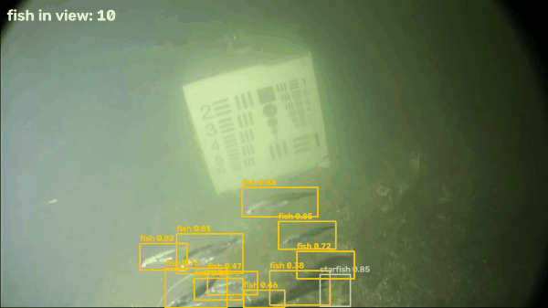<br>
  <sub>YOLOv8n detecting and tracking fish with the same ONNX detection code the app uses, run on a PC. The clip is Brackish Dataset footage (a public underwater dataset), not a real pond, taken from the part of the video that has no labels, so the model never saw these frames in training.</sub>
</p>

## Problem statement

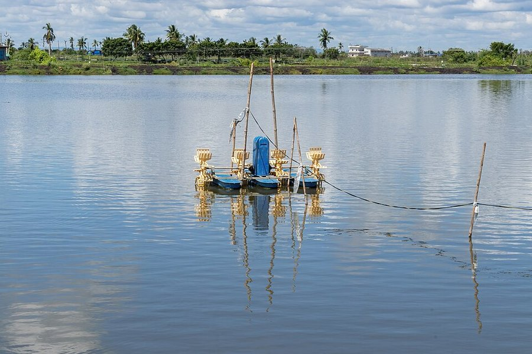

In fish and shrimp ponds, stock is often lost when water quality changes quickly, for example when dissolved oxygen drops at night or after an algal bloom. Small farms check the water by hand once or twice a day, so a problem that starts at night may not be found until morning. Probes that stay in the water and run all the time would catch it, but they foul, drift and need power and regular cleaning, which is hard to keep up with on a small farm.

Fish change how they behave when the water goes bad: they gather and gasp at the surface when oxygen is low, and they slow down when they are stressed. AquaSense is designed to watch the fish with a camera and switch the probes on when the fish look wrong. It also schedules readings at fixed times: 05:00, when oxygen is lowest, and 15:00, when pH and temperature peak.

<sub>Photo: aerators in an aquaculture pond near Eluru, Andhra Pradesh (iMahesh, CC BY-SA 4.0)</sub>

<br clear="right">

## Features

- **Fish detection on the Linux side:** YOLOv8n exported to ONNX (416 px) for ONNX Runtime on the UNO Q's Cortex-A53 cores. Letterbox and NMS are written in NumPy, so the UNO Q would not need PyTorch.
- **Behaviour checks:** a centroid tracker gives each fish's speed in body lengths per second. Every 10 s the app compares fish count, share near the surface, speed and water colour with what it learned as normal, and raises `surface_crowding`, `low_activity`, `hyperactivity`, `fish_missing`, `motionless_fish` or `water_colour`. Windows that are too dark to see the fish raise nothing.
- **Probes only when needed:** the STM32 switches each probe on through a P-MOSFET, waits for it to settle, takes 64 ADC samples and switches it off. One probe at a time, so pH, EC and DO electrodes don't interfere in the same water. Everything is off at boot.
- **Water chemistry:** pH with two- or three-point calibration and temperature correction, dissolved oxygen corrected for temperature, salinity and altitude, salinity from conductivity (PSS-78), TDS, turbidity, and the share of ammonia in its toxic NH3 form (calculated from pH and temperature, ammonia itself is not measured).
- **Species limits:** tilapia, Indian major carps, pangasius and vannamei shrimp, with plain advice in the log ("Low dissolved oxygen: switch on aeration, stop feeding...").
- **Scheduled and follow-up checks:** 05:00 and 15:00 every day, and every 10 minutes while a value is out of range.
- **Local alarm and control:** an RGB LED shows the water status, a buzzer sounds on critical readings, and an optional relay starts an aerator when oxygen is low (with hysteresis, so it does not toggle on every reading).
- **Keeps running when things fail:** if the STM32 stops answering, the measurement is aborted, the probes are switched off and it is retried later instead of the app crashing.
- **Logging:** every measurement, every 10 s behaviour summary and every alert that starts a measurement go to CSV files in the app's data folder, with camera snapshots of alerts (at most one a minute).

## Tech stack

| area | used |
|---|---|
| board | Arduino UNO Q 4 GB: Qualcomm QRB2210 (Debian Linux) + STM32U585 (Arduino core on Zephyr) |
| embedded | C++, Arduino_RouterBridge (RPC between Linux and the MCU), ADC, I2C, 1-Wire via DS2484 |
| edge AI | YOLOv8n, ONNX Runtime, OpenCV, NumPy |
| training | Ultralytics YOLOv8, PyTorch (CUDA, RTX 3050 laptop GPU), Kaggle API |
| app and tools | Python, Arduino App Lab, arduino-cli, pytest, GitHub Actions |
| hardware (planned parts) | DFRobot Gravity pH, DO, EC and turbidity sensors, DS18B20, USB webcam, P-MOSFET probe switches |

## System architecture

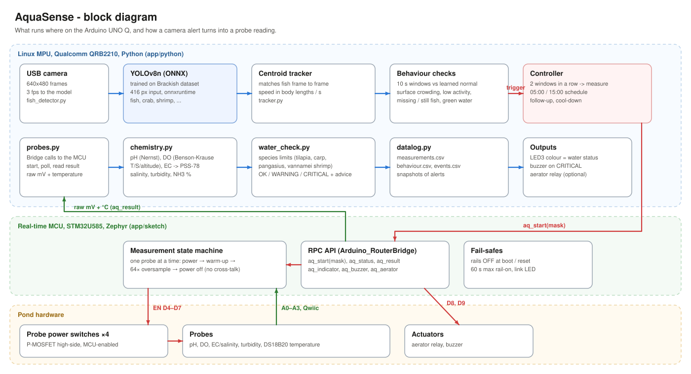

1. The USB camera sends frames to YOLOv8n on the Linux side, 3 frames per second.
2. The tracker follows each fish between frames and measures its speed.
3. Every 10 s the behaviour checks compare the numbers with the learned baseline.
4. When alerts show up in two windows in a row, Python asks the STM32 over the Arduino Bridge to take a measurement.
5. The STM32 powers each probe in turn, reads it and sends back raw millivolts.
6. Python converts the readings, checks them against the species limits, logs everything, sets the LED, sounds the buzzer if needed and can switch the aerator.

**Why the UNO Q.** It has two processors on one UNO-sized board. The QRB2210 (4x Cortex-A53, 4 GB RAM, Debian) handles the camera, the neural network and the decision logic in Python. The STM32U585 (Cortex-M33, 160 MHz) owns the 3.3 V headers: the analog inputs, the GPIOs that switch the probes, the Qwiic I2C port and two of the board's four built-in RGB LEDs. Timing-sensitive work (probe warm-up, ADC sampling, switching probes off) stays on the microcontroller, so its timing does not depend on how busy Linux is with YOLO.

<p align="center">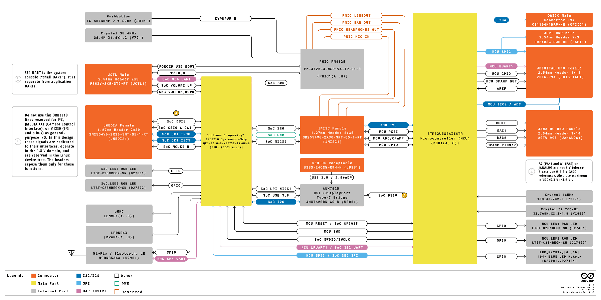<br><sub>UNO Q block diagram: QRB2210 on the left, STM32U585 on the right (image: Arduino, CC BY-SA 4.0)</sub></p>

| camera alert | what it usually means |
|---|---|
| `surface_crowding` | low dissolved oxygen, fish gasping |
| `low_activity` | stress, cold water, low oxygen |
| `hyperactivity` | irritation, pH or ammonia problems |
| `fish_missing` | fish hiding or sick at the bottom |
| `motionless_fish` | a dead or sick fish |
| `water_colour` | algal bloom or turbid water |

Wiring:

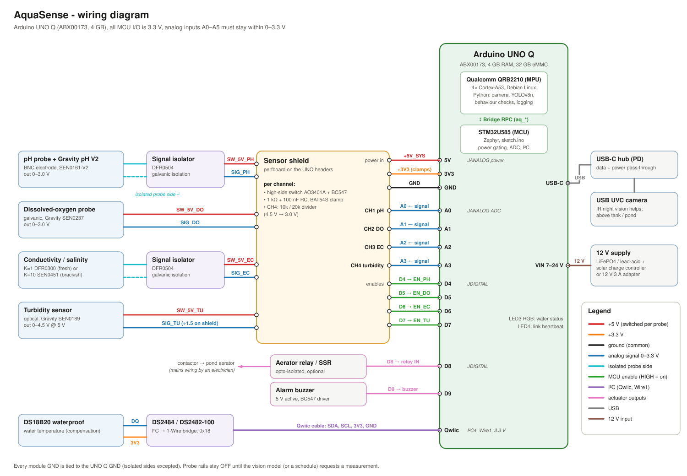

| part | measures | UNO Q pin |
|---|---|---|
| DFRobot Gravity analog pH V2 (SEN0161-V2) + DFR0504 isolator | pH | A0, power switch on D4 |
| DFRobot Gravity analog dissolved oxygen kit (SEN0237) | dissolved oxygen | A1, switch on D5 |
| DFRobot conductivity DFR0300 (K=1) or SEN0451 (K=10) + DFR0504 isolator | conductivity, salinity, TDS | A2, switch on D6 |
| DFRobot Gravity turbidity (SEN0189) through a 10k/20k divider | turbidity | A3, switch on D7 |
| DS18B20 on a DS2484 I2C-to-1-Wire bridge | water temperature | Qwiic (I2C4) |
| USB webcam on a USB-C hub | fish behaviour | USB-C |
| 5 V buzzer, relay or SSR for an aerator | alarm, aeration | D9, D8 |

More detail: [docs/how-it-works.md](docs/how-it-works.md), schematics and pin notes in [hardware/README.md](hardware/README.md).

## Installation

**Hardware.** Build the probe shield (four P-MOSFET switches, input filters and clamps, turbidity divider) and wire the sensors as in [hardware/README.md](hardware/README.md). The UNO Q's analog pins take 3.3 V at most.

**Board.**

1. Install Arduino App Lab, connect the UNO Q over USB-C, and finish the first-run setup (Wi-Fi, updates).
2. Copy the `app/` folder to the board as an App Lab app, either with *Import app* (zip the folder) or over SSH:
   ```
   scp -r app arduino@<board-ip>:~/ArduinoApps/aquasense
   ```
3. Create `app/python/config.local.yaml` with your species and probe calibration (example values):
   ```yaml
   species: indian_major_carp
   altitude_m: 120
   calibration:
     ph: {cal_temp_c: 27.5, points: [[2041, 4.0], [1512, 7.0], [990, 10.0]]}
   ```
4. Plug the webcam into a powered USB-C hub connected to the UNO Q and power the UNO Q from VIN (7-24 V).

**PC (tools and tests).**

```
pip install -r requirements.txt pytest   # run the pipeline on videos, run the tests
pip install -r training/requirements.txt  # only for retraining the model
```

Full steps: [docs/uno-q-setup.md](docs/uno-q-setup.md).

## Usage

- **Run on a UNO Q** (not tried on hardware yet): open the app in App Lab and press Run. App Lab flashes `app/sketch` to the STM32 and starts `app/python/main.py`. The app is written to print one line every 10 s (fish count, surface share, speed, inference time, alerts) and every measurement with its advice. Logs go to `app/data/`.
- **Status LED:** green = water OK, blue = measuring, yellow = warning, red = critical.
- **Calibrate the probes:** put each probe in its standard, read the raw millivolts from `data/measurements.csv` and run `python tools/calibration_helper.py ph --mv7 ... --mv4 ... --mv10 ...` (steps in [docs/calibration.md](docs/calibration.md)).
- **Try it on a video on a PC (no hardware needed):** any underwater video works, for example one of the clips in `dataset/videos/` of the Brackish download from Kaggle (see [training/README.md](training/README.md)). The STM32 is replaced by a stand-in that returns example probe values.
  ```
  python tools/run_on_video.py clip.avi --out annotated.mp4
  ```
- **Measure inference speed on a UNO Q:**
  ```
  python tools/benchmark.py --model app/python/models/aquasense_yolov8n_416.onnx
  ```
- **Retrain the model:** see [training/README.md](training/README.md).

## Project structure

```
app/                        Arduino App Lab app, the folder that goes on the UNO Q
├── app.yaml
├── sketch/                 STM32U585 firmware (C++)
│   ├── sketch.ino          measurement state machine, Bridge functions, LEDs, buzzer, relay
│   ├── config.h            pins, ADC settings, warm-up times
│   └── ds2484.h            DS2484 I2C-to-1-Wire driver + DS18B20
└── python/                 QRB2210 / Debian side (Python)
    ├── main.py             main loop: camera -> detector -> tracker -> behaviour -> controller
    ├── fish_detector.py    YOLOv8 ONNX inference, letterbox, NMS
    ├── tracker.py          centroid tracker, speed in body lengths/s
    ├── behaviour.py        10 s window metrics, learned baseline, alert rules, water colour
    ├── controller.py       when to measure: camera alerts, schedule, follow-ups, cool-down, retries
    ├── settings.py         loads config.yaml and merges config.local.yaml
    ├── probes.py           Bridge client for the MCU, result parsing
    ├── chemistry.py        mV -> pH, DO, conductivity, salinity, turbidity, NH3 fraction
    ├── water_check.py      species limits and advice
    ├── datalog.py          CSV logs and snapshots
    ├── config.yaml         settings, calibration, species profiles
    └── models/             aquasense_yolov8n_416.onnx, classes.txt
training/                   dataset conversion, training, ONNX export, evaluation, plots, weights
hardware/                   wiring diagram, schematics, parts and pin notes
docs/                       how it works, UNO Q setup, calibration, images
tools/                      run on a video, benchmark the model, calibration helper
tests/                      pytest for the Python side (run in GitHub Actions with the sketch compile)
```

## Dataset and models

| | |
|---|---|
| dataset | [Brackish Dataset](https://www.kaggle.com/datasets/aalborguniversity/brackish-dataset) (Kaggle, Aalborg University): fixed underwater camera in murky brackish water, 89 videos, about 14.7k annotated frames |
| split used | official train / val / test lists: 5,896 training images (every 2nd frame), 1,467 val, 1,468 test |
| classes | fish, crab, shrimp, jellyfish, starfish (`fish` and `small_fish` merged) |
| model | YOLOv8n (3.0 M parameters, 8.2 GFLOPs at 640 px), fine-tuned from COCO weights |
| training | 640 px, 60 epochs, batch 16, about 1.1 h on an RTX 3050 laptop GPU |
| model used by the app | `app/python/models/aquasense_yolov8n_416.onnx` (12.7 MB, 416x416 input, NMS done in NumPy) |

I picked the Brackish footage because it is murky, low-visibility water filmed by a fixed camera, which is much closer to a farm pond than clear aquarium or reef photos. Its labels ship in pixel units with 1-based class ids, so [training/prepare_brackish.py](training/prepare_brackish.py) converts them to standard YOLO format first. Training, export and evaluation steps are in [training/README.md](training/README.md).

## Results

**Model accuracy** on the held-out test split (1,468 frames):

| input size | precision | recall | mAP@0.5 | mAP@0.5:0.95 |
|---|---|---|---|---|
| 640 px (training size) | 0.957 | 0.934 | 0.966 | 0.739 |
| 416 px (input size used by the app) | 0.949 | 0.882 | 0.939 | 0.671 |

For the fish class alone mAP@0.5 is 0.957 at 640 px and 0.912 at 416 px. Per-class numbers are in [training/results/metrics.md](training/results/metrics.md). The official split is per frame, so test frames come from the same videos as the training frames. A new pond will score lower until the model is fine-tuned on its own footage.

Training curves (loss and validation metrics per epoch):

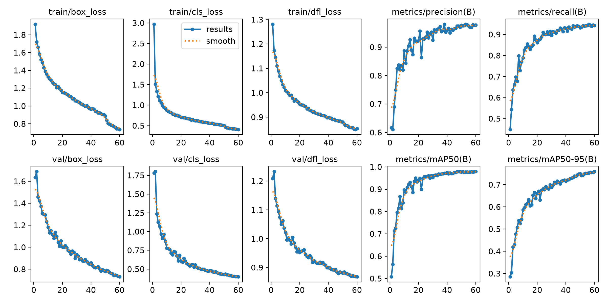

Test images, ground truth labels on the left and the exported ONNX model on the right:

<p align="center">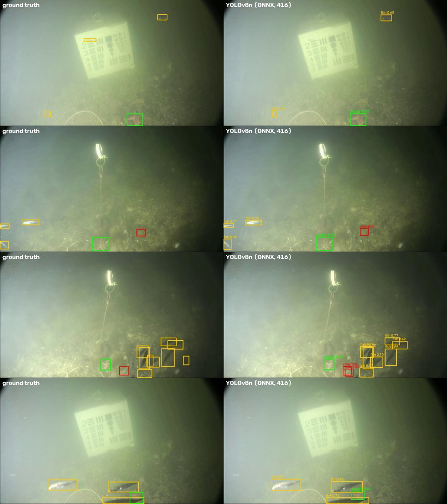</p>

**Firmware:** the STM32 sketch compiles (arduino-cli, also in CI) to 114 KB of 786 KB flash (14 %) and 49 KB of 262 KB RAM (18 %).

**Inference speed:** about 17 ms per frame for the 416 px model with ONNX Runtime on a laptop CPU (Intel 12th gen, 4 threads, median of 50 runs, `tools/benchmark.py`). It has not been measured on a UNO Q yet; `tools/benchmark.py` is there for that.

## Photos

<table>
  <tr>
    <td align="center">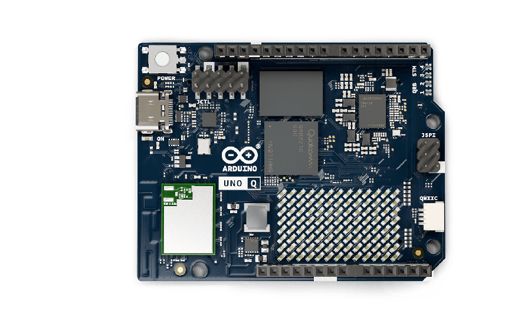<br>Arduino UNO Q</td>
    <td align="center">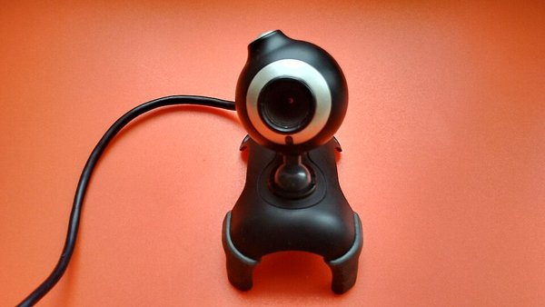<br>USB webcam</td>
    <td align="center">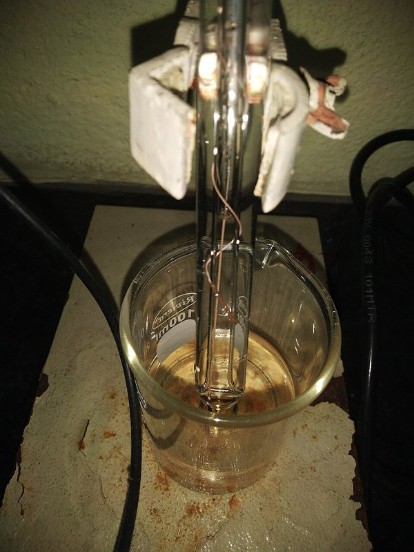<br>pH electrode</td>
  </tr>
  <tr>
    <td align="center">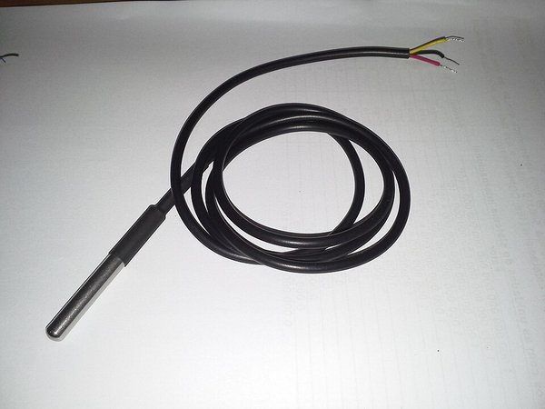<br>DS18B20 waterproof probe</td>
    <td align="center">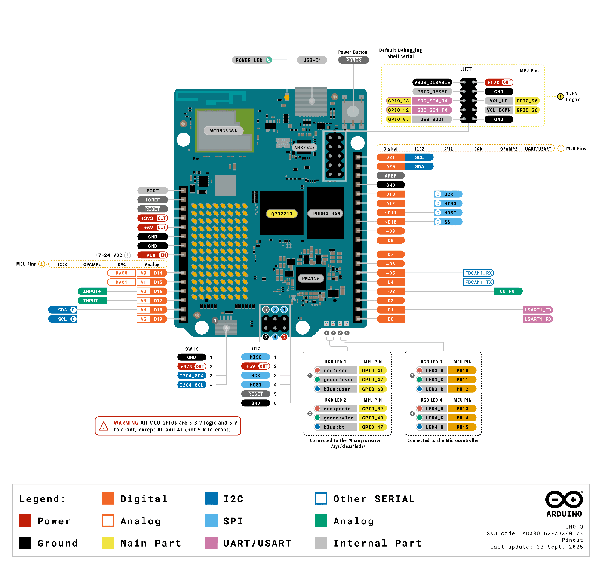<br>UNO Q pinout</td>
    <td align="center">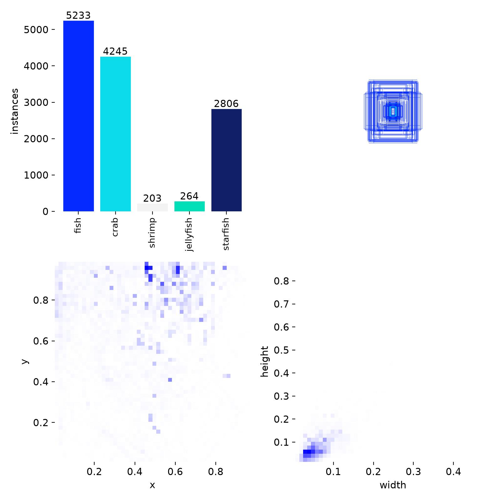<br>training label distribution</td>
  </tr>
</table>

These are stock photos of the parts in the design, not photos of a built device. Credits and licenses: [docs/images/components/CREDITS.md](docs/images/components/CREDITS.md).

## Future scope

- Build the device, run it on a UNO Q with the probes connected, and test it in a real pond.
- Fine-tune YOLOv8n on footage from a real farm pond (tilapia, carp) with a few hundred labelled frames.
- Add an IR camera so the fish can be watched at night, when oxygen problems usually start.
- Train a behaviour model on recorded, labelled events instead of fixed statistical rules.
- Add ammonia (NH4+ ion-selective electrode) and ORP probes.
- Quantise the model to INT8 for faster inference on the A53 cores.
- SMS or LoRa alerts for farms without Wi-Fi, and solar power with sleep between checks.
- Several nodes per farm reporting to one place.

## Credits and license

Code: MIT ([LICENSE](LICENSE)). Brackish Dataset: M. Pedersen, J. B. Haurum, R. Gade, T. B. Moeslund, N. Madsen, *Detection of Marine Animals in a New Underwater Dataset with Varying Visibility*, CVPR Workshops 2019, CC BY-SA 4.0. The trained model and dataset-derived images are shared under CC BY-SA 4.0, and the YOLOv8 weights also fall under the Ultralytics AGPL-3.0 terms.

---

Ankit Choudhury, [github.com/Ankit02124](https://github.com/Ankit02124)
