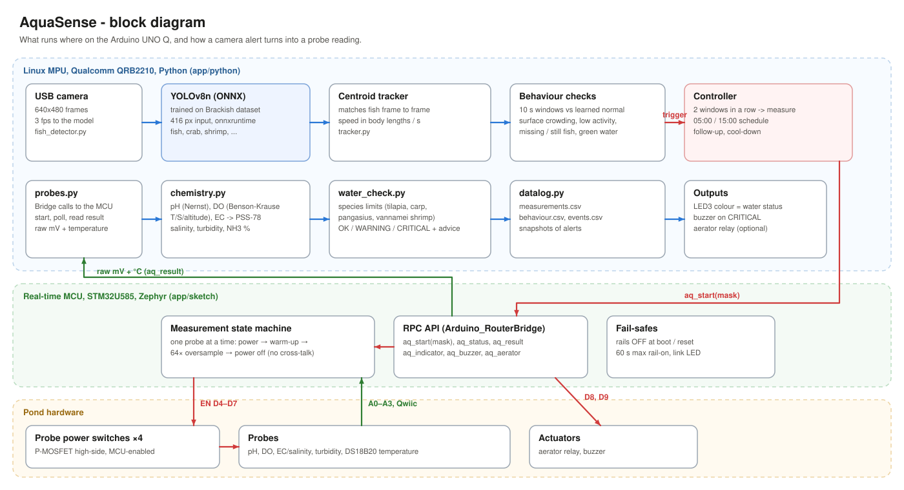

# How it works



The UNO Q has two processors and the project uses both:

| | Qualcomm QRB2210 (Linux) | STM32U585 (MCU) |
|---|---|---|
| code | `app/python` | `app/sketch` |
| does | camera, YOLO, tracking, behaviour checks, decisions, logging | switching the probes on and off, ADC readings, temperature over I2C, LEDs, buzzer, relay |

Arduino App Lab starts both halves together: it flashes the sketch to the STM32 and runs `main.py` on Linux. They talk through the Arduino Bridge (`Bridge.call` in Python, `Bridge.provide_safe` in the sketch).

## 1. Fish detection

`fish_detector.py` runs a YOLOv8n model exported to ONNX at 416x416. Preprocessing (letterbox, BGR to RGB, scale to 0-1) and NMS are written in numpy, so the board only needs `onnxruntime`. There is no torch or ultralytics on the UNO Q.

The model was trained on the Brackish Dataset, which is footage from a fixed underwater camera in murky brackish water (see [training/README.md](../training/README.md)). It detects fish, crab, shrimp, jellyfish and starfish. Only `fish` is used for the behaviour checks.

The camera is read at 10 fps but only 3 frames per second go to the model. That is enough to follow fish movement and leaves CPU headroom.

## 2. Tracking

`tracker.py` matches each new fish box to the nearest box from the previous frame. Distance is measured in body lengths (the longest side of the box), so the same thresholds work for small and large fish and for any camera distance. From the matched positions it gets a speed in body lengths per second, and it notes how long each fish has stayed still.

## 3. Behaviour checks

`behaviour.py` collects per-frame numbers and every 10 seconds takes their median:

| metric | meaning |
|---|---|
| n_fish | fish visible |
| surface_ratio | share of fish in the top 25 % of the image |
| mean_speed | average swimming speed (body lengths/s) |
| active_ratio | share of fish moving faster than 0.3 BL/s |
| green_index, clarity | water colour (excess green) and sharpness, from plain OpenCV |

For the first 5 minutes after start-up these windows only feed the baseline (running mean and standard deviation). After that each window is compared with the baseline:

| alert | rule (defaults in config.yaml) | likely cause |
|---|---|---|
| surface_crowding | ≥ 60 % of fish near the surface and more than 3σ above normal | low oxygen, fish gasping |
| low_activity | speed below half of normal and 3σ below it | stress, cold, low oxygen |
| hyperactivity | speed above twice normal and 3σ above it | irritation, pH or ammonia problems |
| fish_missing | fewer than 30 % of the usual number of fish | fish hiding or sick at the bottom |
| motionless_fish | one fish not moving for 3 minutes | dead or sick fish |
| water_colour | water much greener or less clear than normal | algal bloom, turbidity |

Windows with an alert are not added to the baseline, so a problem that lasts a long time does not become the new normal. The fish rules (all but `motionless_fish` and `water_colour`) only run when at least 3 fish are normally in view (`min_fish`). Windows darker than `dark_level` (night without IR light) raise no alerts and are left out of the baseline, so a black image is never taken for "fish missing".

## 4. When the probes are switched on

`controller.py` starts a measurement when:

- the camera reports alerts in **two windows in a row** (20 s). They don't have to be the same alert. A single odd window is common with only a handful of fish in view, so it does not trigger anything.
- a **scheduled time** is reached: 05:00, when dissolved oxygen is lowest and the camera sees little, and 15:00, when pH and temperature peak.
- the last result was WARNING or CRITICAL. It then re-measures every 10 minutes until the water is back in range.
- the app starts, to get one reference reading.

After a camera-triggered measurement, camera alerts are ignored for 15 minutes so one event doesn't keep cycling the probes.

```mermaid
sequenceDiagram
    participant Cam as camera + YOLO
    participant Ctl as controller.py
    participant MCU as sketch.ino
    participant P as probes
    Cam->>Ctl: surface_crowding (2 windows)
    Ctl->>MCU: aq_start(31)
    MCU->>P: read DS18B20 via DS2484
    loop pH, DO, EC, turbidity
        MCU->>P: switch on, wait warm-up
        MCU->>P: 64 ADC samples, switch off
    end
    Ctl->>MCU: aq_status() (polled from the main loop)
    MCU-->>Ctl: DONE
    Ctl->>MCU: aq_result()
    MCU-->>Ctl: R1;seq=4;t=28.1;ph=1561.2;do=640.3;...
    Ctl->>Ctl: convert, compare with species limits, log
    Ctl->>MCU: aq_indicator(3), aq_buzzer(1)
```

## 5. On the MCU

The sketch keeps a small state machine in `loop()`:

```
IDLE -> (aq_start) -> temperature conversion (800 ms) -> for each requested probe:
        switch on -> wait warm-up -> 64 samples -> switch off -> DONE
```

- One probe at a time, to avoid cross-talk between electrodes in the same water.
- 64 samples per probe; the highest and lowest 8 are dropped and the rest are averaged.
- Warm-up times (pH 15 s, DO 10 s, EC 5 s, turbidity 2 s) are sent from `config.yaml` at start-up.
- A probe is never left on longer than 60 s, even if something goes wrong.
- At boot every switch is off before the Bridge even starts.

A full measurement takes about 35 s. That is too long for one Bridge call, so Python starts it with `aq_start` and polls `aq_status`.

### Bridge functions

| function | returns |
|---|---|
| `aq_ping()` | `"AquaSense MCU 1.0"` |
| `aq_start(mask)` | 1 if started. Mask bits: 1 temp, 2 pH, 4 DO, 8 EC, 16 turbidity |
| `aq_status()` | `"BUSY,2,5,12"` = state, step, total steps, measurement number |
| `aq_result()` | `"R1;seq=12;t=27.94;ph=1561.2;do=702.4;ec=74.9;tu=2790.3;f=0"` |
| `aq_abort()` | switches all probes off |
| `aq_indicator(level)` | LED3: 0 green, 1 blue, 2 yellow, 3 red |
| `aq_buzzer(on)`, `aq_aerator(on)` | outputs on D9 and D8 |
| `aq_set_warmup(channel, ms)` | warm-up per probe |

`f` in the result is a bit field: 1 = temperature failed, 2 = ADC saturated, 8 = a probe hit the 60 s limit.

If a Bridge call fails or times out (MCU not answering), `probes.py` returns safe values instead of raising, the controller treats it as a failed measurement, switches the probes off and retries after the follow-up interval. Scheduled times are read in the `timezone` set in `config.yaml`, because the App Lab container may run on UTC.

The MCU only sends raw millivolts. Calibration lives in Python (`chemistry.py`), so changing calibration never needs a re-flash, and the raw value is stored in `measurements.csv` in case the calibration has to be redone later.

## 6. From millivolts to water quality

| value | how |
|---|---|
| pH | two- or three-point calibration (pH 4, 7, 10 buffers, least-squares line) with Nernst temperature correction |
| dissolved oxygen | % saturation from the probe × oxygen solubility (Benson & Krause, corrected for temperature, salinity and altitude) |
| conductivity / salinity | DFRobot board transfer × cell constant, salinity from the PSS-78 equations |
| turbidity | DFRobot's published curve for SEN0189 |
| NH3 fraction | share of total ammonia in the toxic form, from pH and temperature (Emerson 1975) |

`water_check.py` compares the values with the limits for the farmed species (`species_profiles` in `config.yaml`) and writes plain advice to the log, for example "Low dissolved oxygen: switch on aeration, stop feeding, exchange some water."

## 7. Output

The project has no web app. Everything is visible in the App Lab console and in the app's `data/` folder:

- `measurements.csv`: every probe reading with the reason, level, raw string and advice
- `behaviour.csv`: one row per 10 s window with all metrics and alerts
- `events.csv`: camera alerts that started a measurement, and failed measurements
- `snapshots/`: annotated camera frames saved whenever an alert fires

On the board itself, LED3 shows the water status, the buzzer sounds on CRITICAL, and the optional relay can start an aerator. The aerator is switched off again only when DO is 1 mg/L above the warning level (`aerator_off_margin`), so it does not toggle on every reading near the limit. LED4 blinks green while Linux keeps talking to the MCU (it pings once a minute) and red if it stops.
