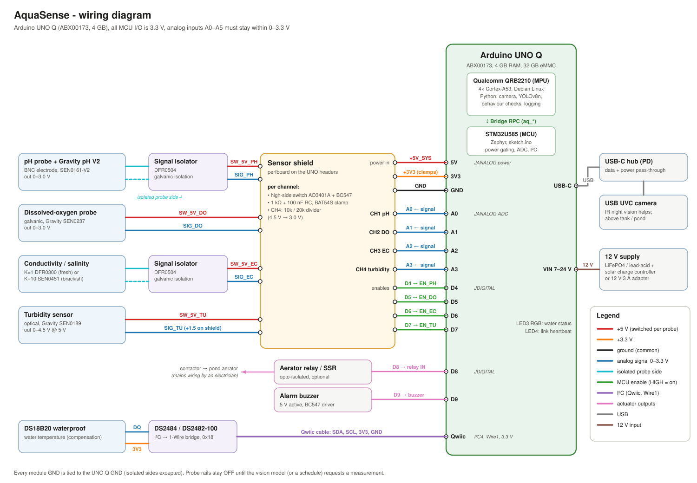
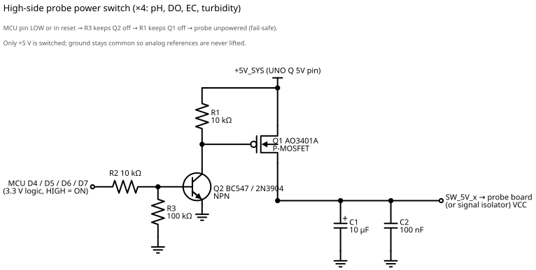
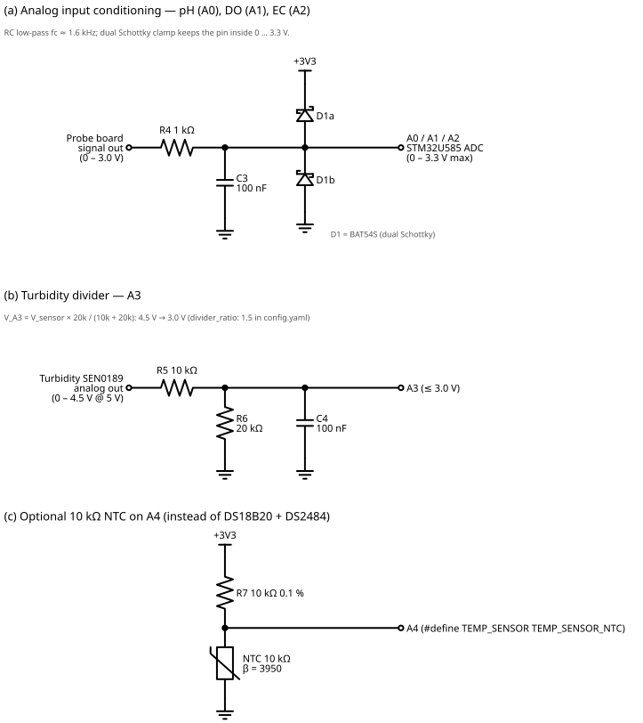
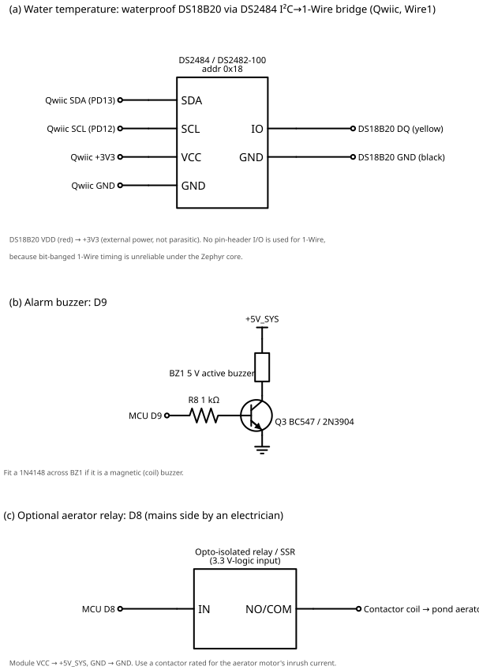

# Hardware



## Parts

| Part | Used for | Notes |
|---|---|---|
| Arduino UNO Q, 4 GB (ABX00173) | everything | Linux side runs the camera and YOLO, the STM32 side runs the probes |
| USB webcam (UVC) + USB-C hub with PD | fish camera | a cheap 720p webcam is enough. Use an IR model if you want night images |
| DFRobot Gravity analog DO kit (SEN0237) | dissolved oxygen | galvanic probe, output 0-3.0 V |
| DFRobot Gravity analog pH V2 (SEN0161-V2) | pH | output 0-3.0 V |
| DFRobot DFR0300 (K=1), or SEN0451 (K=10) for brackish ponds | conductivity, salinity | K=1 probe tops out around 20 mS/cm |
| DFRobot SEN0189 | turbidity | runs on 5 V, output up to 4.5 V so it needs a divider |
| 2x DFRobot DFR0504 analog signal isolator | pH and EC channels | stops the probes interfering through the water |
| DS18B20 waterproof probe + DS2484 (or DS2482-100) breakout | water temperature | DS2484 sits on the Qwiic port |
| 4x AO3401A P-MOSFET, 4x BC547, resistors, caps | probe power switches | see schematics below |
| 3x BAT54S, 1 kΩ and 100 nF | ADC input protection | |
| 5 V active buzzer + BC547 | local alarm | |
| Relay or SSR module (optional) | aerator | switch a contactor coil, not the motor directly |
| 12 V supply or battery | power into VIN | VIN accepts 7-24 V |

The DFRobot probe boards were chosen because they are easy to buy and have documented transfer curves. Any probe with a 0-3 V analog output works if you update `chemistry.py`.

## Pin map

All MCU pins on the UNO Q are 3.3 V. A0-A5 are not 5 V tolerant when used as analog inputs (absolute max about 3.6 V), which is why the pH, DO and EC inputs (A0-A2) have a BAT54S clamp and the 5 V turbidity sensor goes through a divider on A3.

| Pin | Connected to |
|---|---|
| A0 | pH board (through isolator) |
| A1 | DO board |
| A2 | EC board (through isolator) |
| A3 | turbidity sensor through 10k/20k divider |
| A4 | optional 10k NTC instead of the DS18B20 |
| D4, D5, D6, D7 | power switch for pH, DO, EC, turbidity (HIGH = on) |
| D8 | aerator relay |
| D9 | buzzer |
| Qwiic (I2C4, `Wire1` in the sketch) | DS2484 → DS18B20 |
| 5V | probe power switches, buzzer, relay module |
| 3V3 | clamp diodes, DS18B20 |
| VIN | 12 V |
| USB-C | hub → webcam |

The on-board RGB LED3 shows the last water status (green ok, blue measuring, yellow warning, red critical) and stays off until the first reading. LED4 is a link heartbeat: it blinks blue until Linux first talks to the MCU, then green every 3 s (main.py pings the MCU once a minute), and red if Linux has been silent for 15 minutes.

## Schematics

**Probe power switch** (built 4 times). The MCU pin drives a BC547, which pulls the gate of a P-MOSFET low and connects the probe to 5 V. R1 and R3 keep the switch off while the MCU is in reset or being flashed. Only the 5 V line is switched, ground stays common.



**Analog inputs.** Each probe signal goes through 1 kΩ with 100 nF to ground and a BAT54S clamp to 3V3/GND. The turbidity sensor gets a 10k/20k divider, so 4.5 V becomes 3.0 V (`divider_ratio: 1.5` in the config).



**Temperature, buzzer, relay.**



## Why the probes are switched on one at a time

pH, EC and DO probes sit in the same water, so their grounds are connected through the water. The EC board drives an AC current through the water, which shifts the pH reading noticeably, and the galvanic DO probe also produces its own current. The sketch powers one probe, waits for it to settle, reads it, and switches it off before the next one. pH and EC also go through isolators. Turbidity is optical and needs neither.

## Why a DS2484 for the temperature probe

Bit-banged 1-Wire timing is not reliable on the Zephyr-based UNO Q core. The DS2484 generates the 1-Wire timing in hardware, and the MCU talks to it over I2C on the Qwiic port (`Wire1`). If you don't have one, a 10k NTC on A4 works too: set `TEMP_SENSOR` to `TEMP_SENSOR_NTC` in `app/sketch/config.h`.

## Power

The UNO Q running YOLO plus a webcam draws a few watts continuously. The probes only draw power for about 35 s per measurement. For a pond without mains, a 12 V LiFePO4 battery with a small solar panel and charge controller into VIN is the simplest setup. Measure your actual draw before sizing the battery.

## Installation notes

- Put the DO probe 30-50 cm deep and away from aerator bubbles, they make it read high.
- Keep the pH probe wet all the time.
- The stainless steel sheath of most waterproof DS18B20 probes is connected to its ground wire. In the water this ties the circuit ground to the pond and the pH reading drifts or jumps. Cover the sheath with heat-shrink tube, sealed at the tip, so only plastic touches the water.
- Clean the probes weekly in warm ponds. Algae on the DO membrane makes it read low.
- Mount the camera rigidly. If it moves, restart the app so it re-learns what normal looks like.
- The board goes in an IP65 box in the shade. Heat is a bigger problem than rain.
- Anything on mains (aerator) must be wired by an electrician, with an RCD on the circuit.

## Drawings

The SVGs are drawn by scripts in `drawings/` so they can be edited as text:

```
python hardware/drawings/diagrams.py      # wiring diagram + block diagram, no dependencies
pip install schemdraw
python hardware/drawings/schematics.py    # the three schematics
```
