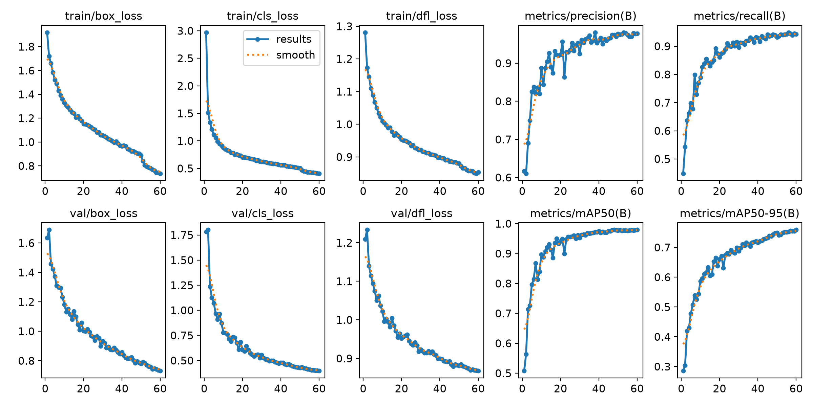
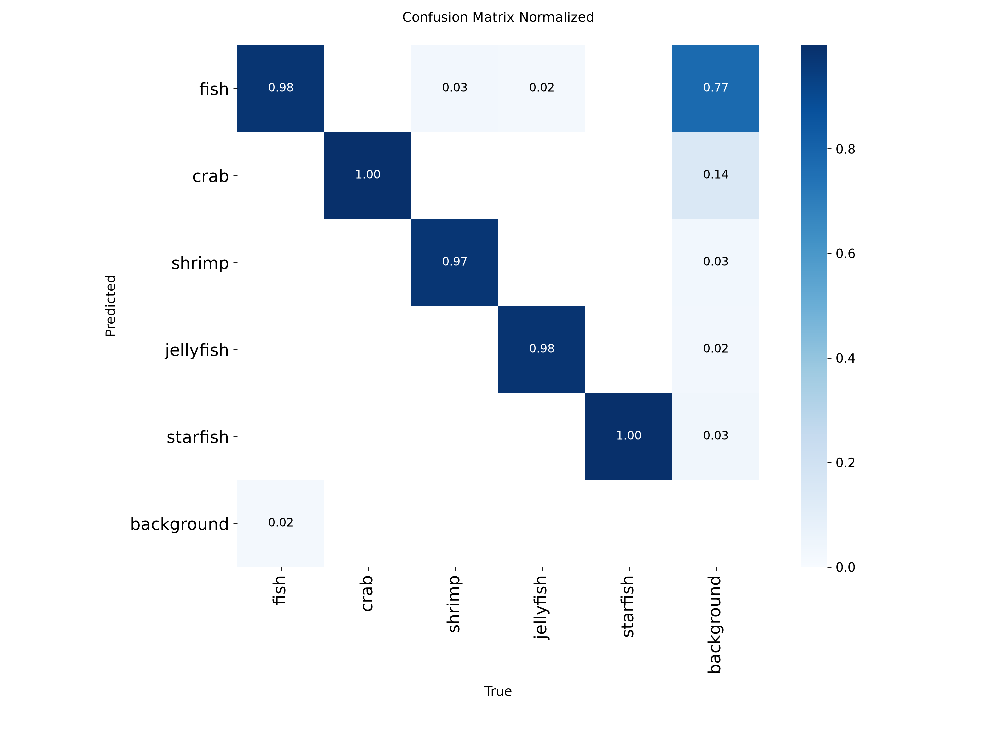
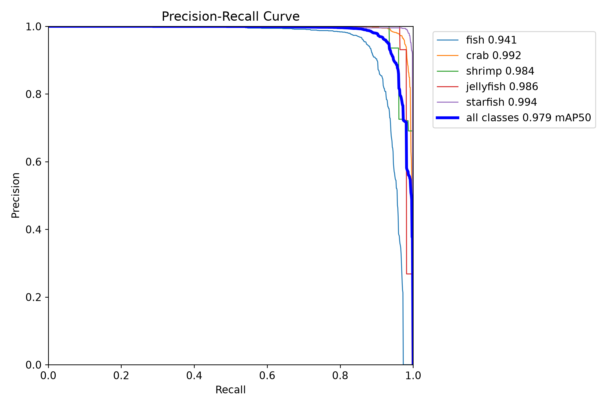
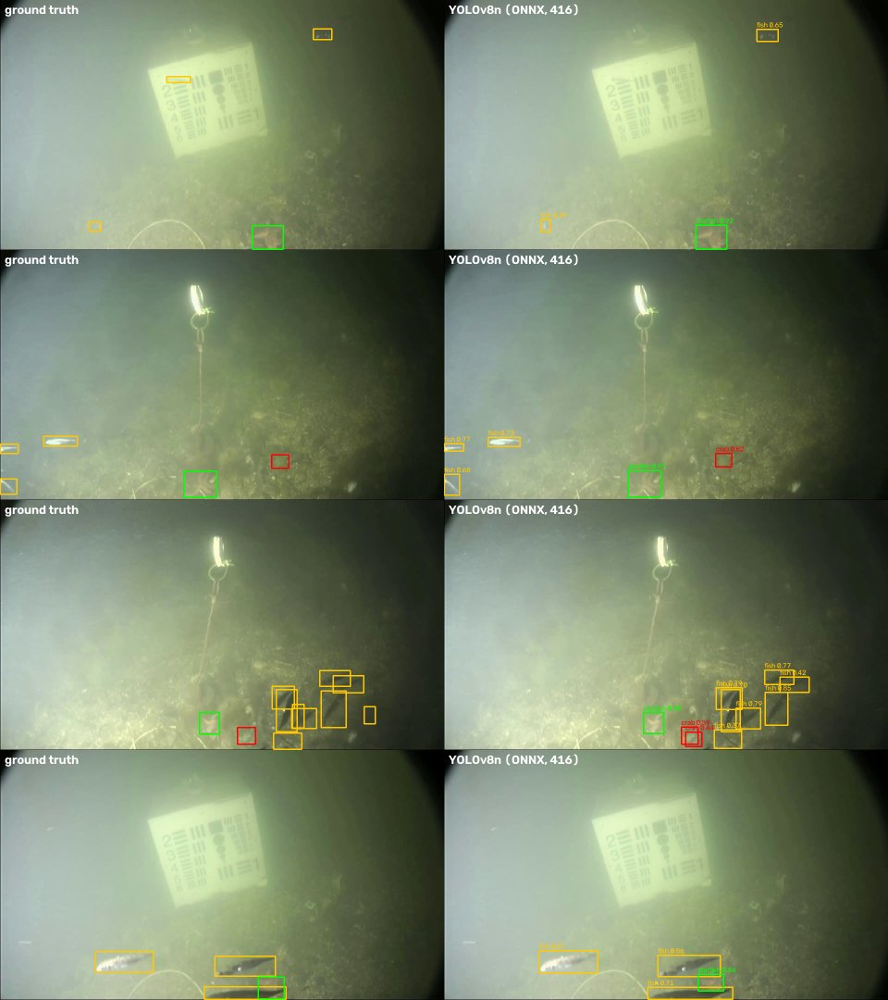

# Training the fish detector

## Dataset choice

I looked at the fish detection datasets on Kaggle that have bounding boxes:

| dataset | why not / why |
|---|---|
| Roboflow Aquarium (aquarium-data-cots) | only 638 images, clear aquarium water, includes penguins and puffins |
| Fish Detection (various Roboflow exports) | mixed internet photos, not a fixed camera |
| DeepFish | large, but clear tropical reef water |
| **Brackish Dataset** (aalborguniversity/brackish-dataset) | fixed underwater camera, murky water with changing visibility, ~14.7k annotated frames, published baseline. Closest to watching a pond. |

## Getting the data

You need a Kaggle API token (Kaggle → Settings → API). Set it as an environment variable, don't put it in a file in the repo:

```
pip install -r training/requirements.txt
set KAGGLE_API_TOKEN=<your token>          (Linux/macOS: export KAGGLE_API_TOKEN=...)
kaggle datasets download aalborguniversity/brackish-dataset -p data/brackish --unzip
python training/prepare_brackish.py --src data/brackish --dst data/brackish-yolo
```

The download is 173 MB: 89 .avi videos, the annotations, and the official train/valid/test frame lists. `prepare_brackish.py` decodes the videos with OpenCV and writes the frames that appear in the split lists.

Two things in this dataset that are easy to miss:

1. The files in `annotations_YOLO` are **not** normalised YOLO labels. A line like `6 432 474 66 78` is class 6 (1-based, so `starfish`) with centre x, centre y, width and height **in pixels** of the 960x540 frame. Fed directly to Ultralytics, every label gets rejected as "out of bounds" and the model trains on empty images. The script normalises the boxes and remaps the classes.
2. The official split is random **per frame**, so all 89 videos appear in train, val and test. Test frames have almost identical neighbours in the training set, which makes the test score optimistic for a new camera or a new place.

After conversion: 5,896 training images (every 2nd frame), 1,467 val, 1,468 test. Classes: fish (fish + small_fish merged), crab, shrimp, jellyfish, starfish.

## Training

```
python training/train.py --data data/brackish-yolo/brackish.yaml
```

YOLOv8n from COCO weights, 640 px, batch 16, 60 epochs (early stopping patience 15), mosaic switched off for the last 10 epochs, slightly stronger brightness augmentation because the underwater lighting changes a lot. Training took 1.1 hours on an RTX 3050 Laptop GPU (4 GB). The best weights are in [weights/yolov8n_brackish_best.pt](weights/yolov8n_brackish_best.pt), the full training log in [results/results.csv](results/results.csv) and the training arguments in [results/train_args.yaml](results/train_args.yaml) (local paths shortened). With this Ultralytics version the run folder is `runs/detect/runs/yolov8n_brackish/`.

## Model accuracy

Test split (1,468 frames), from `evaluate.py`:

| image size | class | precision | recall | mAP@0.5 | mAP@0.5:0.95 |
|---|---|---|---|---|---|
| 640 | all | 0.957 | 0.934 | 0.966 | 0.739 |
| 640 | fish | 0.947 | 0.907 | 0.957 | 0.683 |
| 640 | crab | 0.980 | 0.978 | 0.992 | 0.788 |
| 640 | shrimp | 0.901 | 0.877 | 0.952 | 0.654 |
| 640 | jellyfish | 0.983 | 0.912 | 0.932 | 0.640 |
| 640 | starfish | 0.974 | 0.994 | 0.995 | 0.932 |
| 416 | all | 0.949 | 0.882 | 0.939 | 0.671 |
| 416 | fish | 0.924 | 0.844 | 0.912 | 0.603 |
| 416 | crab | 0.957 | 0.945 | 0.977 | 0.691 |
| 416 | shrimp | 0.899 | 0.777 | 0.892 | 0.578 |
| 416 | jellyfish | 0.966 | 0.855 | 0.920 | 0.595 |
| 416 | starfish | 0.997 | 0.990 | 0.995 | 0.889 |

416 px is what runs on the board. Keep in mind the per-frame split noted above: these numbers say the model learned this camera well, not how it will do on a different pond.



| confusion matrix | precision-recall |
|---|---|
|  |  |

Predictions of the exported ONNX model (the file the UNO Q uses), with ground truth on the left:



## Export for the UNO Q

```
python training/export.py --weights training/weights/yolov8n_brackish_best.pt --imgsz 416
python training/evaluate.py --weights training/weights/yolov8n_brackish_best.pt --data data/brackish-yolo/brackish.yaml
```

`export.py` writes `app/python/models/aquasense_yolov8n_416.onnx` (opset 12, no NMS in the graph) and `classes.txt`. 416 px is a compromise: at 640 px small fish are found more often (see the accuracy table above), but a 640 px input has about 2.4x the pixels of a 416 px one, so it needs roughly that much more compute per frame. `tools/benchmark.py` measures the real speed on the board.

## Fine-tuning on your own pond

The Brackish camera sits 9 m deep in a strait with an LED light on, so its fish look different from tilapia in a farm pond. To adapt the model:

1. Record a few videos of the pond with the same camera, then pull clean frames out of them with `python tools/run_on_video.py pond.mp4 --save-raw frames/ --raw-every 5`. (The app's alert snapshots have boxes drawn on them, so they are not usable as training images.)
2. Label a few hundred of them in YOLO format (Label Studio, CVAT, Roboflow).
3. Add them to the dataset folders and run `train.py` with `--model training/weights/yolov8n_brackish_best.pt` and fewer epochs.
